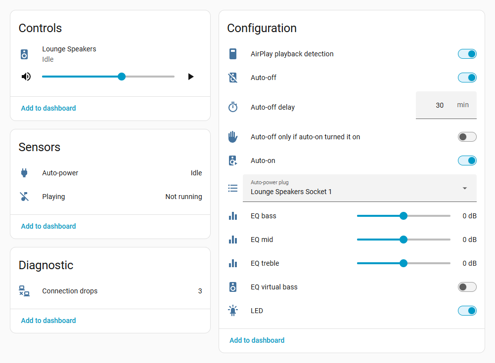
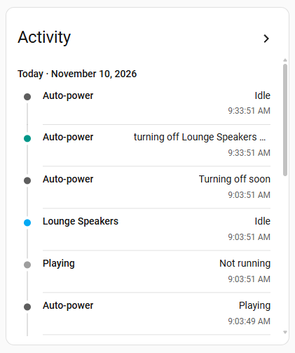

<p align="center">
  
</p>

<h1 align="center">Arylic - LP Series for Home Assistant</h1>

<p align="center">
  Local control, play-state detection and automatic speaker power<br>
  for Arylic LP-series network streamers.
</p>

<p align="center">
  <a href="https://github.com/biddies4africa/ha-arylic-lp/releases/latest"></a>
  <a href="https://my.home-assistant.io/redirect/hacs_repository/?owner=biddies4africa&repository=ha-arylic-lp&category=integration"></a>
  
  <a href="https://github.com/biddies4africa/ha-arylic-lp/actions/workflows/tests.yaml"></a>
  <a href="https://github.com/biddies4africa/ha-arylic-lp/blob/main/LICENSE"></a>
</p>

<p align="center">
  <a href="#installation"><b>Installation</b></a>
  &nbsp;·&nbsp;
  <a href="https://github.com/biddies4africa/ha-arylic-lp/blob/main/docs/user-guide.md"><b>User guide</b></a>
  &nbsp;·&nbsp;
  <a href="https://github.com/biddies4africa/ha-arylic-lp/issues/new/choose"><b>Report an issue</b></a>
</p>

<p align="center">
  
</p>

## Features

- **Play state from any source.** Knows when the player is playing, whichever app or input
  started it, including Spotify Connect, AirPlay, TIDAL Connect, internet radio and Bluetooth.
  No cloud account, shell access or adb is needed.
- **Automatic speaker power.** Switches the speakers' smart plug on when playback starts, and off
  after a set time with nothing playing. Every command is confirmed, retried if needed, and
  recorded in the player's activity log.
- **Full player control.** Volume, mute, source, play/pause and track skipping through a standard
  media player, plus bass, mid, treble, virtual bass and the front LED.
- **Automatic discovery.** Players on your network are found automatically and followed if their
  address changes. Add as many as you like, each with its own plug and settings.
- **Entirely local.** Everything stays on your network.

> [!NOTE]
> **Compatibility.** Tested on the Arylic LP10. Other LP-series models, and other Arylic devices on
> the same Libre-based firmware that expose the control API on TCP port 2018, should also work.
> If you try one, please
> [send a compatibility report](https://github.com/biddies4africa/ha-arylic-lp/issues/new/choose),
> whether it works or not.

## Requirements

- Home Assistant 2026.3 or newer.
- An Arylic LP-series player that Home Assistant can reach on these ports:

  | Port | Used for | Required |
  |---|---|---|
  | TCP 2018 | Control and play state | Yes |
  | TCP 7000 | AirPlay session check | No |
  | UDP 1800 | Player identity and discovery | Recommended |

- Optionally, a smart plug that powers the speakers. Any `switch`, `light` or `input_boolean` can
  be used.

Players on the same network as Home Assistant are discovered automatically, and their address is
followed if it changes. A player on a different network or VLAN can be added by its IP address,
but then needs a fixed address, such as a DHCP reservation.

## Installation

### HACS (recommended)

[](https://my.home-assistant.io/redirect/hacs_repository/?owner=biddies4africa&repository=ha-arylic-lp&category=integration)

1. Select the button above. Alternatively, in HACS, open the **⋮** menu, select
   **Custom repositories**, and add `https://github.com/biddies4africa/ha-arylic-lp` as an
   **Integration**.
2. Select **Download**, then restart Home Assistant.

### Manual installation

1. Download the [latest release](https://github.com/biddies4africa/ha-arylic-lp/releases/latest).
2. Copy its `custom_components/arylic_lp` folder into the `config/custom_components` folder of your
   Home Assistant installation.
3. Restart Home Assistant.

### Adding a player

[](https://my.home-assistant.io/redirect/config_flow_start/?domain=arylic_lp)

1. Discovered players appear under **Settings** > **Devices & services**. Select **Add** to set
   one up. Alternatively, select **Add integration**, search for **Arylic - LP Series**, and enter
   the player's IP address.
2. Choose the plug that powers the speakers, or leave the field empty to use play state and
   controls only. You can link or change the plug later on the player's device page.

The [user guide](https://github.com/biddies4africa/ha-arylic-lp/blob/main/docs/user-guide.md)
walks through each step with screenshots.

## Configuration

Each player's settings can be changed at any time, either on its device page or by selecting
**Configure** on the integration's page.

| Setting | Where to change it | Description |
|---|---|---|
| IP address | **Reconfigure** | The player's address. Players on the same network are followed automatically. |
| Name | During setup | Defaults to the name the player reports. |
| Auto-power plug | Device page or **Configure** | The plug that auto-power controls: any `switch`, `light` or `input_boolean`. Leave it empty to turn auto-power off. |
| AirPlay playback detection | Device page or **Configure** | Also treats an active AirPlay session as playing. On by default. |

## Entities

Each player is added as a device. Entity IDs are based on the player's name.

| Entity | Section | Description |
|---|---|---|
| `media_player.<name>` | Controls | Volume, mute, source, play/pause and next/previous track. |
| `binary_sensor.<name>_playing` | Sensors | On while the player is playing. Its attributes show the underlying signals. |
| `number.<name>_eq_bass`, `_eq_mid`, `_eq_treble` | Configuration | Tone, from −10 to +10 dB. Stored on the player. |
| `switch.<name>_eq_virtual_bass` | Configuration | Virtual bass. Stored on the player. |
| `switch.<name>_led` | Configuration | Front LED and display. Stored on the player. |
| `select.<name>_auto_power_plug` | Configuration | The plug that auto-power controls, or **No plug**. |
| `switch.<name>_airplay_playback_detection` | Configuration | Treats an active AirPlay session as playing. |
| `sensor.<name>_connection_drops` | Diagnostic | How often the player has become unreachable, and when it last happened. |

When a plug is linked, these entities are added:

| Entity | Section | Description |
|---|---|---|
| `sensor.<name>_auto_power` | Sensors | What auto-power is doing: **Playing**, **Idle**, **Turning off soon** or **Player unavailable**. Attributes include `turns_off_at`, the last action and any error. |
| `switch.<name>_auto_on` | Configuration | Switches the plug on when playback starts. |
| `switch.<name>_auto_off` | Configuration | Switches the plug off after the delay with nothing playing. |
| `switch.<name>_auto_off_only_if_auto_on_turned_it_on` | Configuration | Leaves a plug that was switched on by hand alone. |
| `number.<name>_auto_off_delay` | Configuration | Minutes with nothing playing before switching off: 1 to 240, default 30. |

Auto-power settings and the connection drop count are kept across restarts. Home Assistant lists a
device's entities alphabetically, so the names are chosen to keep related settings together.
Installations from before v0.5.0 keep their original entity IDs.

## Automation example

Turn the volume down in the evening:

```yaml
automation:
  - alias: "Lounge: quieter after 9 pm"
    triggers:
      - trigger: time
        at: "21:00:00"
    actions:
      - action: media_player.volume_set
        target:
          entity_id: media_player.lounge_speakers
        data:
          volume_level: 0.15
```

The [user guide](https://github.com/biddies4africa/ha-arylic-lp/blob/main/docs/user-guide.md#7-automations)
has more examples, including a notification when a plug fails to switch.

## How it works

The player exposes Arylic's plain-text control API on TCP port 2018, which relays commands to its
microcontroller. The integration keeps one persistent connection to each player:

- Play state (`PLA;`) is polled every 2 seconds.
- Volume, source, mute, tone and LED state (`STA;`, `MID;` and `VBS;`) are read every 30 seconds.
- The player broadcasts every reply to all connected clients, so a change made in another app
  arrives immediately.
- When AirPlay detection is on, the AirPlay receiver's session flag (`http://<ip>:7000/info`) is
  used as a second playback signal.
- The player's identity (name, model, firmware and MAC address) comes from its discovery responder
  on UDP port 1800.

The API does not report track details such as title, artist or artwork, and cannot tell paused
from stopped, so the player shows as either playing or idle.

### Reliability

- **The plug is switched on when playback starts**, not whenever the player is playing. If you
  switch the plug off by hand during a song, it stays off. Playback that is already running when
  Home Assistant starts, or when the player returns after an outage, does not switch it on.
- **Short network interruptions are ignored.** The last known state is held for three failed
  polls before the player shows as unavailable, and the connection is restored with exponential
  backoff, from 1 to 30 seconds.
- **Outages don't cut the music.** While the player is unreachable, the auto-off countdown is at
  least 60 minutes. A brief outage won't switch the speakers off, but a player that has been
  unplugged eventually will. After 10 minutes, a Repairs issue is raised, and it clears when the
  player returns.
- **Plug commands are confirmed and retried.** Each command is checked against the plug's state,
  because cloud-connected plugs can be slow, and retried for up to 20 seconds while it is still
  needed. If every attempt fails, a Repairs issue reports the error.
- **Every auto-power action is recorded** in the player's activity log, and fired as an
  `arylic_lp_autopower` event for use in automations.

<p align="center">
  
</p>

## Troubleshooting

| Symptom | What to check |
|---|---|
| Setup reports *Could not reach the player's control port* | Home Assistant must be able to open TCP port 2018 on the player. Check the address, and if the player is on another network or VLAN, allow the traffic in your router. |
| Entities keep becoming unavailable | Check the **Connection drops** sensor, and make sure nothing else is polling the player with short-lived connections (see the warning below). |
| The player shows as playing when nothing is playing | The player's play flag can stick after a network restart during playback. Switch the source to **Line in** and back to clear it. |
| The speakers don't switch on | Make sure **Auto-on** is on, and check the **Auto-power** sensor's `last_error` attribute. The plug is switched on when playback *starts*. |

> [!WARNING]
> **Don't poll the player with short-lived connections.** On the LP10, opening a new connection to
> TCP port 2018 for each query every few seconds crashes the player's relay, and the player then
> restarts its network, staying offline for about 90 seconds. This integration uses a single
> persistent connection, so avoid running other scripts that poll the port in this way.

For anything else, download the player's diagnostics from its device page (**⋮** >
**Download diagnostics**) and
[open an issue](https://github.com/biddies4africa/ha-arylic-lp/issues/new/choose) with the file
attached. Diagnostics leave out the player's address, MAC address and time zone, so they're safe to
share.

## Security

> [!IMPORTANT]
> The players' control port (TCP 2018) has no authentication: any device on your network can
> change the volume or source. This is a property of the firmware, not of this integration, so
> keep the players on a network you trust. To report a security problem with the integration, see
> the [security policy](https://github.com/biddies4africa/ha-arylic-lp/blob/main/SECURITY.md).

## Tested hardware

| Model | Firmware | Confirmed |
|---|---|---|
| LP10 | `AR241CP_8285.9.1` | Play state (Spotify Connect), volume, mute, source, tone, LED and auto-power. |
| LP10 | `AR241CE_8530.23.2` | Status, volume, source, tone and LED. Play state not yet confirmed during playback. TCP 2018 stopped responding once; a full power cycle, not a soft reboot, restored it. |

Play state has not yet been confirmed for Bluetooth or line-in. AirPlay playback is also detected
through the AirPlay session check.

## Removal

1. Go to **Settings** > **Devices & services** > **Arylic - LP Series**, and delete each player
   from its **⋮** menu.
2. Remove the integration in HACS (**⋮** > **Remove**). If you installed it manually, delete the
   `config/custom_components/arylic_lp` folder instead.
3. Restart Home Assistant.

<details>
<summary><b>Development</b></summary>

<br>

```sh
pip install -r requirements_test.txt
pytest
ruff check . && ruff format --check .
```

The tests use `pytest-homeassistant-custom-component` with a simulated player. Continuous
integration runs Ruff, pytest, hassfest and HACS validation on every push.

</details>

## How it was built

I built this integration with [Claude Code](https://claude.com/claude-code), Anthropic's AI
coding tool. Claude wrote most of the code, tests and documentation, and ran the automated tests
and the code and security reviews. I decided what the integration should do, run it at home on two
LP10s, and check every change on that setup before it is released. All the code is here to read;
if you spot a problem, please [open an issue](https://github.com/biddies4africa/ha-arylic-lp/issues/new/choose).

## Support

Arylic - LP Series is an independent project, built and maintained in my spare time. If it's
useful to you, you can shout me a coffee.

<a href="https://ko-fi.com/jandalengineering">
  <picture>
    <source media="(prefers-color-scheme: dark)" srcset="https://raw.githubusercontent.com/biddies4africa/ha-arylic-lp/main/.github/assets/shout-me-a-coffee-dark.svg">
    
  </picture>
</a>

## Licence

Released under the [MIT licence](https://github.com/biddies4africa/ha-arylic-lp/blob/main/LICENSE).
This project is not affiliated with or endorsed by Arylic or Libre Wireless. Product names are
trademarks of their respective owners. The icon is an original illustration of a generic streamer
front panel, not Arylic's logo.
