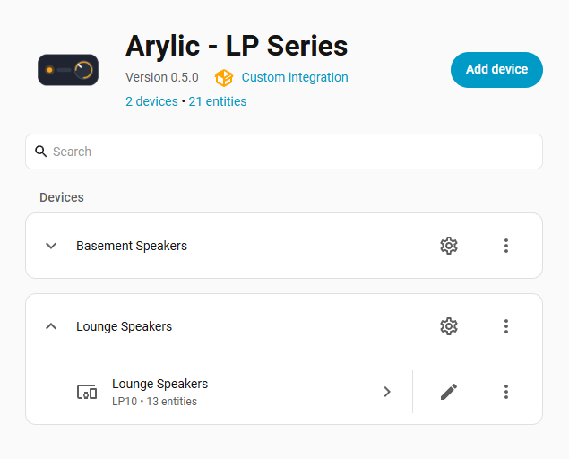
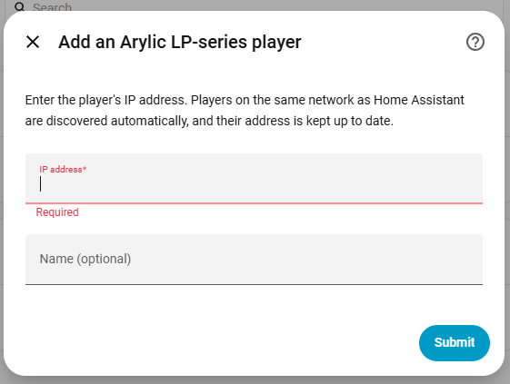
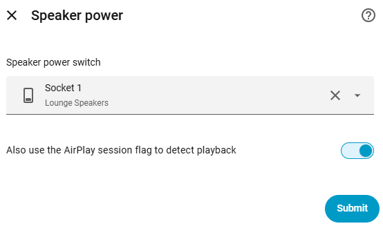
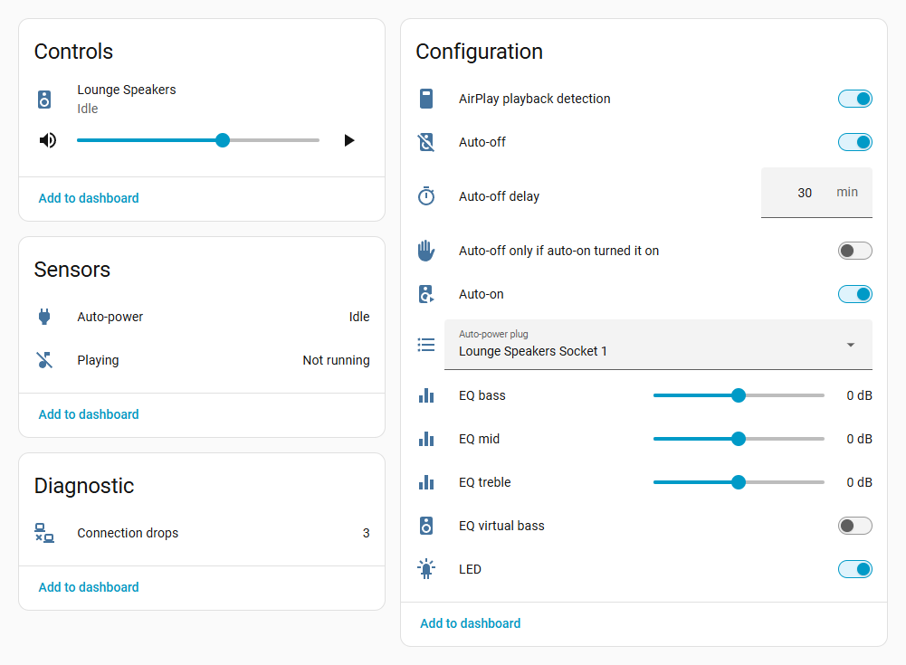
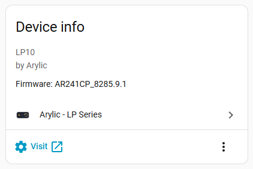
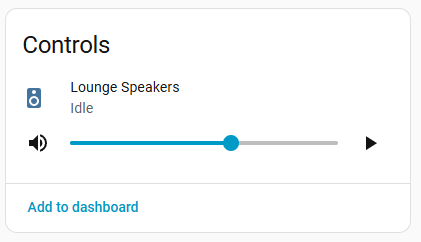
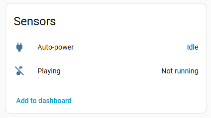
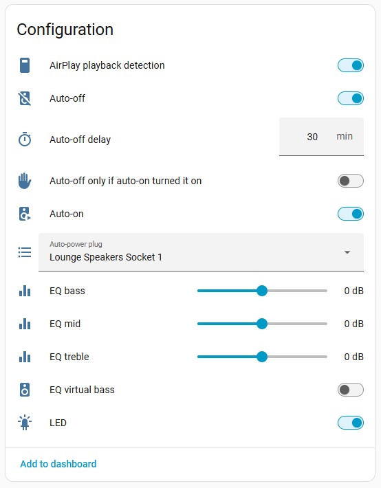
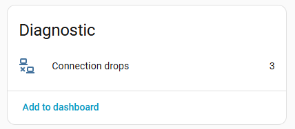
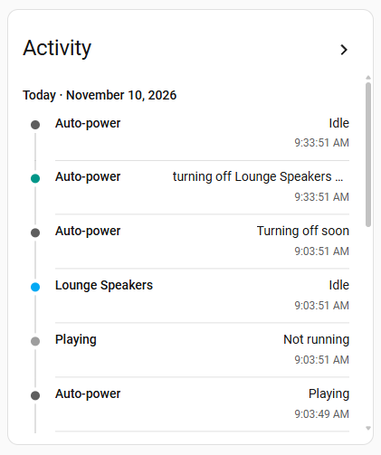

<p align="center">
  
</p>

<h1 align="center">User guide</h1>

<p align="center">
  Arylic - LP Series for Home Assistant
</p>

This guide covers installing the integration, adding a player, every part of the player's device
page, and setting up automatic speaker power. For a compact technical reference, see the
[README](../README.md).

## Contents

1. [Before you start](#1-before-you-start)
2. [Installation](#2-installation)
3. [Adding a player](#3-adding-a-player)
4. [The device page](#4-the-device-page)
5. [Speaker auto-power](#5-speaker-auto-power)
6. [Changing settings](#6-changing-settings)
7. [Automations](#7-automations)
8. [Troubleshooting](#8-troubleshooting)
9. [Removing the integration](#9-removing-the-integration)

## 1. Before you start

You will need:

- **Home Assistant 2026.3 or newer.**
- **An Arylic LP-series player.** The integration is tested on the LP10. Other models on the same
  Libre-based firmware should also work if they respond on TCP port 2018. If you try one, please
  [send a compatibility report](https://github.com/biddies4africa/ha-arylic-lp/issues/new/choose).
- **Network access from Home Assistant to the player.** TCP port 2018 is required. TCP port 7000
  (AirPlay session check) and UDP port 1800 (player identity) are optional. On the same network as
  Home Assistant, no setup is needed; across networks or VLANs, allow this traffic in your router.
- **Optionally, a smart plug for the speakers.** Any `switch`, `light` or `input_boolean` can be
  used.

> [!NOTE]
> The player's local interface does not report track details such as title, artist or artwork,
> and cannot tell paused from stopped. The integration therefore shows the player as either
> playing or idle.

## 2. Installation

### HACS (recommended)

1. In HACS, open the **⋮** menu and select **Custom repositories**.
2. Add `https://github.com/biddies4africa/ha-arylic-lp` with the type **Integration**.
   Alternatively, use the **Open in HACS** button in the README.
3. Find **Arylic - LP Series**, select **Download**, and restart Home Assistant.

HACS will notify you when a new version is available.

### Manual installation

1. Download the [latest release](https://github.com/biddies4africa/ha-arylic-lp/releases/latest).
2. Copy its `custom_components/arylic_lp` folder into the `config/custom_components` folder of your
   Home Assistant installation.
3. Restart Home Assistant.

## 3. Adding a player

### Discovered players

Players on the same network as Home Assistant announce themselves, and usually appear under
**Settings** > **Devices & services** as **Discovered**. Select **Add**, confirm, and continue with
[the speaker power step](#the-speaker-power-step).

### Adding a player by IP address

Go to **Settings** > **Devices & services** > **Arylic - LP Series** and select **Add device**. If
the integration isn't set up yet, select **Add integration** and search for **Arylic**.

<p align="center">
  
</p>

Enter the player's IP address. The name is optional: if you leave it empty, the name the player
reports is used.

<p align="center">
  
</p>

> [!IMPORTANT]
> A player on a different network from Home Assistant can't be followed if its address changes.
> Give it a fixed address, such as a DHCP reservation in your router. Players on the same network
> are followed automatically.

### The speaker power step

Finally, you're asked about speaker power. This is the same screen that **Configure** shows later,
and its two settings also appear on the player's device page.

<p align="center">
  
</p>

- **Auto-power plug:** the plug that powers the speakers. Leave it empty to use play state and
  controls only. You can link a plug later on the device page.
- **AirPlay playback detection:** a second way of detecting AirPlay playback. We recommend leaving
  it on.

Select **Submit**, and the player is ready to use.

## 4. The device page

Each player has its own device page. To open it, go to **Settings** > **Devices & services** >
**Arylic - LP Series** and select the player. Home Assistant groups the player's entities into
cards.

<p align="center">
  
</p>

> [!TIP]
> Each card has an **Add to dashboard** button, which is the quickest way to put the player's
> controls or settings on a dashboard.

### Device info

<p align="center">
  
</p>

Shows the model and firmware version that the player reports. **Visit** opens the player's own
web page.

### Controls

<p align="center">
  
</p>

The player appears as a media player, with:

- **Volume and mute.** The volume buttons change the level in 2% steps.
- **Play/pause, next and previous track.** These control whichever app is playing, just like the
  buttons on the player.
- **Source:** Network, Bluetooth, Line in or USB, selected from the player's dialog.

Its state is either **Playing** or **Idle**. Changes made elsewhere, for example in the Arylic app
or with the player's own buttons, usually appear immediately and always within 30 seconds.

### Sensors

<p align="center">
  
</p>

**Playing** is on while the player is playing from any source. Home Assistant labels this type of
sensor **Running** or **Not running**. Its attributes show the signals it is based on:

| Attribute | Description |
|---|---|
| `mcu_play_flag` | The player's own play flag. |
| `airplay_session` | Whether an AirPlay session is active, when AirPlay detection is on. |
| `source` | The current source code: `NET`, `BT`, `LINE-IN` or `USBPLAY`. |

**Auto-power** appears once a plug is linked, and shows what auto-power is doing:

| State | Meaning |
|---|---|
| Playing | Music is playing, and the plug stays on. |
| Idle | Nothing is playing and no countdown is running: the plug is off, or auto-off doesn't apply. |
| Turning off soon | Nothing is playing, and the plug will be switched off at the time in `turns_off_at`. |
| Player unavailable | Home Assistant can't reach the player. |

Its attributes also show the linked plug (`power_switch`), whether auto-power switched it on
(`turned_on_by_autopower`), and the last action, when it happened, and any error.

### Configuration

<p align="center">
  
</p>

Home Assistant lists these settings alphabetically, and their names keep related settings
together.

| Setting | Description | Stored by |
|---|---|---|
| **AirPlay playback detection** | Also treats an active AirPlay session as playing. Takes effect immediately. | Home Assistant |
| **Auto-off** | Switches the plug off once the delay has passed with nothing playing. | Home Assistant |
| **Auto-off delay** | Minutes with nothing playing before the plug is switched off: 1 to 240, default 30. | Home Assistant |
| **Auto-off only if auto-on turned it on** | Leaves a plug that was switched on by hand alone. | Home Assistant |
| **Auto-on** | Switches the plug on when playback starts. | Home Assistant |
| **Auto-power plug** | The plug that auto-power controls, or **No plug**. | Home Assistant |
| **EQ bass**, **EQ mid**, **EQ treble** | Tone, from −10 to +10 dB. | The player |
| **EQ virtual bass** | The player's bass enhancement. | The player |
| **LED** | The front LED and display. | The player |

The four **Auto-** settings appear once a plug is linked. Settings stored by the player are the
same ones the Arylic app changes, so a change made in either place appears in both. Settings
stored by Home Assistant are kept across restarts.

> [!TIP]
> The **Auto-power plug** list includes each switch, light and input_boolean that is a device's
> main control. It leaves out other integrations' settings switches, hidden or disabled entities,
> and this integration's own switches. If the plug you want isn't listed, link it with
> [Configure](#6-changing-settings), which accepts any of them.

### Diagnostic

<p align="center">
  
</p>

**Connection drops** counts how often the player has become unreachable, and is kept across
restarts. Its `last_drop` attribute shows when the most recent drop happened. An occasional drop
is normal, because the LP10 restarts its network from time to time. A steadily rising count points
to a network problem, or to another program polling the player (see
[Troubleshooting](#8-troubleshooting)).

### Activity

<p align="center">
  
</p>

The player's activity log. As well as state changes, every auto-power action is recorded here:

| Message | Meaning |
|---|---|
| *turning on Lounge Speakers Socket 1 (playback started)* | Auto-on is switching the plug on. |
| *turning off Lounge Speakers Socket 1 (idle)* | The auto-off delay has passed. |
| *turning off … (player unreachable)* | The player stayed unreachable for the whole of the longer countdown. |
| *attempt 2 failed: no response* | The plug didn't respond. Auto-power will try again. |
| *turned on … (attempt 3)* | The action succeeded after retrying. |
| *gave up after 5 attempts* | Every attempt failed. A Repairs issue explains why. |
| *stopped retrying: playback stopped* | The action was no longer needed, so the retries stopped. |

## 5. Speaker auto-power

### Setting it up

Choose the speakers' plug in **Auto-power plug** on the device page. The auto-power settings and
the **Auto-power** sensor appear immediately, with defaults that suit most setups: the plug is
switched on when playback starts, and off 30 minutes after it stops.

### How it works

1. **Playback starts.** If the plug is off, auto-power switches it on. This only happens when
   playback *starts*, so if you switch the plug off by hand during a song, it stays off.
2. **Playback stops.** The **Auto-power** sensor shows **Turning off soon**, and the countdown
   begins, using the **Auto-off delay**.
3. **Playback resumes before the countdown ends.** The countdown is cancelled.
4. **The countdown ends.** The plug is switched off.

Two situations are deliberately not treated as playback starting, so a plug that is off stays
off:

- Home Assistant starting while the player is already playing.
- The player becoming reachable again after an outage, still playing.

### Common setups

| You want to | Set |
|---|---|
| Switch the speakers on with the music, and off half an hour after it stops | The defaults |
| Switch the speakers off sooner or later | **Auto-off delay**, from 1 to 240 minutes |
| Have the speakers switch on automatically, but switch them off yourself | **Auto-off** off |
| Switch the speakers on yourself, but have them switch off automatically | **Auto-on** off |
| Keep the speakers on when you've switched them on by hand, for example for the TV | **Auto-off only if auto-on turned it on** on |

### When a plug doesn't respond

Cloud-connected plugs can be slow to respond, and sometimes fail. Auto-power checks that the plug
has actually switched, and if it hasn't, tries again for up to 20 seconds while the action is
still needed. Each attempt is recorded in [Activity](#activity). If every attempt fails, Home
Assistant raises a Repairs issue (*Could not turn on …*) with the error, which clears the next
time auto-power succeeds.

### When the player is unreachable

- **Short interruptions are ignored.** The last known state is held for three failed checks, about
  six seconds, before the entities show as unavailable.
- **Outages don't cut the music.** While the player is unreachable, the auto-off countdown is at
  least 60 minutes. A brief network problem won't switch the speakers off, but a player that has
  been unplugged eventually will.
- **After 10 minutes,** a Repairs issue (*… is unreachable*) is raised. It clears when the player
  returns.

## 6. Changing settings

**On the device page:** every setting in the [Configuration](#configuration) card, including the
linked plug and AirPlay detection.

**With Configure:** go to **Settings** > **Devices & services** > **Arylic - LP Series**, and
select the cog next to the player. This opens the same **Speaker power** screen as during setup,
and accepts any switch, light or input_boolean.

**The player's IP address:** players on the same network are followed automatically when their
address changes. For a player added by IP address, open the **⋮** menu next to it, select
**Reconfigure**, and enter the new address.

## 7. Automations

The player's entities can be used in automations like any others. Replace the entity IDs in these
examples with your own.

**Activate a scene when music starts:**

```yaml
automation:
  - alias: "Lounge: music mode"
    triggers:
      - trigger: state
        entity_id: binary_sensor.lounge_speakers_playing
        to: "on"
    actions:
      - action: scene.turn_on
        target:
          entity_id: scene.lounge_music
```

**Turn the volume down in the evening:**

```yaml
automation:
  - alias: "Lounge: quieter after 9 pm"
    triggers:
      - trigger: time
        at: "21:00:00"
    actions:
      - action: media_player.volume_set
        target:
          entity_id: media_player.lounge_speakers
        data:
          volume_level: 0.15
```

**Switch to line in:**

```yaml
action: media_player.select_source
target:
  entity_id: media_player.lounge_speakers
data:
  source: Line in
```

**Send a notification when auto-power can't switch the plug:**

```yaml
automation:
  - alias: "Speakers: plug didn't switch"
    triggers:
      - trigger: event
        event_type: arylic_lp_autopower
        event_data:
          result: gave_up
    actions:
      - action: notify.notify
        data:
          message: >
            Couldn't {{ trigger.event.data.action | replace('_', ' ') }}
            {{ trigger.event.data.power_switch_name }}: {{ trigger.event.data.error }}
```

### The auto-power event

Every auto-power action fires an `arylic_lp_autopower` event, which can be used as an automation
trigger:

| Field | Values |
|---|---|
| `action` | `turn_on` or `turn_off`. |
| `result` | `requested`, `attempt_failed`, `succeeded`, `gave_up` or `cancelled`. |
| `reason` | `playback_started`, `idle` or `player_unreachable`. |
| `power_switch`, `power_switch_name` | The plug's entity ID and name. |
| `attempt`, `error` | The attempt number and the error, where relevant. |
| `entity_id` | The player's **Auto-power** sensor. |

When an action succeeds on the first attempt, only `requested` is fired, followed by the plug's
own state change. `succeeded` is fired when an action succeeds after a retry.

## 8. Troubleshooting

| Symptom | What to check |
|---|---|
| Setup reports *Could not reach the player's control port* | Home Assistant must be able to open TCP port 2018 on the player. Check the address, and if the player is on another network or VLAN, allow the traffic in your router. |
| Entities keep becoming unavailable | Check **Connection drops**, and make sure no other program is polling the player with short-lived connections (see the warning below). |
| The player shows as playing when nothing is playing | Its play flag can stick after a network restart during playback. Switch the source to **Line in** and back to clear it. |
| The speakers don't switch on | Make sure **Auto-on** is on, and check **Activity** and the **Auto-power** sensor's `last_error` attribute. The plug is switched on when playback *starts*. |
| The speakers don't switch off | Make sure **Auto-off** is on. If **Auto-off only if auto-on turned it on** is on, a plug switched on by hand is left on. |
| The plug isn't in the **Auto-power plug** list | It's probably classed as a settings switch, or hidden. Link it with **Configure** instead. |

> [!WARNING]
> **Two quirks of the player's firmware:**
>
> - **Don't poll the player with short-lived connections.** Opening a new connection to TCP port
>   2018 for each query every few seconds crashes the player's relay, and the player then restarts
>   its network, staying offline for about 90 seconds. This integration keeps a single connection
>   open, but other scripts that poll the port in this way will take the player offline.
> - **The play flag can stick on playing** if the player's network restarts during playback.
>   Switching the source to **Line in** and back clears it.

### Getting help

1. On the player's device page, open the **⋮** menu and select **Download diagnostics**. The file
   leaves out the player's address, MAC address and time zone, so it's safe to share.
2. [Open an issue](https://github.com/biddies4africa/ha-arylic-lp/issues/new/choose) and attach the
   file. For a problem with another player model, use the **Compatibility report** form.

For more detail in Home Assistant's log, open **Arylic - LP Series** under **Devices & services**,
select **⋮** > **Enable debug logging**, and reproduce the problem. Disabling debug logging then
downloads the log.

## 9. Removing the integration

1. Go to **Settings** > **Devices & services** > **Arylic - LP Series**, and delete each player
   from its **⋮** menu.
2. Remove the integration in HACS (**⋮** > **Remove**). If you installed it manually, delete the
   `config/custom_components/arylic_lp` folder instead.
3. Restart Home Assistant.
